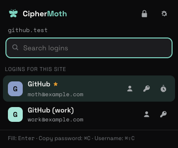
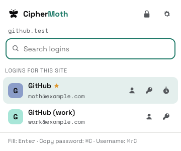

<div align="center">

# CipherMoth

**Your secrets stay in the dark.**

A local-first desktop password manager with **no accounts, no cloud, and no witnesses.**

[](https://github.com/mr-grj/ciphermoth/actions/workflows/ci.yml)
[](https://github.com/mr-grj/ciphermoth/releases/latest)
[](./LICENSE)
[](https://www.python.org/)
[](https://www.sqlite.org/)
[](#get-started)

</div>

---

## What is this?

I built this for myself because I was tired of every password manager wanting my email address, a subscription, a
browser extension with access to everything, and ideally my soul too. Most of the big ones lean on a hosted account,
a sync layer, or a monthly bill by default.

I wanted something that lives on my own machine, has no telemetry, and doesn't wake up one day
to announce it's been acquired and migrating to some new platform. No Google. No OAuth. No analytics pinging home. Nothing.

So there's **CipherMoth**. It lives on your hardware and keeps your secrets in an encrypted local vault. One master password unlocks everything. The optional update check asks GitHub about releases; your vault stays put. If someone gets the vault file, they get encrypted blobs, not your passwords.

## Screenshots

|  |  |
|---|---|
| **First run: set up your master password** | **The vault** |
|  |  |
| **Add a password, generate a strong one** | **Vault health, computed on your device** |
|  |  |
| **The browser extension, only when you ask** | **Light, following your system** |
|  |  |

## Get started

**[Download the latest release](https://github.com/mr-grj/ciphermoth/releases/latest)**. No Python, Docker, or developer tools needed.

| Your machine | Download |
|---|---|
| macOS, Apple Silicon (M-series) | `darwin-aarch64.dmg` |
| macOS, Intel | `darwin-x86_64.dmg` |
| Windows, Intel/AMD | `windows-x86_64.exe` |
| Windows, ARM64 | `windows-aarch64.exe` |
| Linux, Intel/AMD | `linux-x86_64.AppImage` or `.deb` |
| Linux, ARM64 | `linux-aarch64.AppImage` or `.deb` |

Open the DMG and drag **CipherMoth** to Applications, run the Windows installer, or make the Linux AppImage executable and open it. Debian/Ubuntu users can install the `.deb` with `sudo apt install ./<downloaded-file>.deb`.

Open CipherMoth, choose a strong master password, and add your first password. That's it. Your vault lives in your user data folder and survives app updates. The old Alpha app and Docker edition have separate vaults; nothing is moved automatically.

These are free, unsigned-publisher downloads: macOS may require **System Settings → Privacy & Security → Open Anyway**, and Windows may show a SmartScreen warning. Only approve a download you obtained from this project's release page. Organizational policies may prevent installation. [Installation details and updates](docs/UPDATING.md#desktop-updates) explain the limits; never disable OS protections globally.

**Prefer Docker?** The self-hosted edition is still here, with the same encrypted vault core:

```shell
curl -fsSL https://raw.githubusercontent.com/mr-grj/ciphermoth/master/install.sh | sh
```

Then open **[http://localhost:3000](http://localhost:3000)**. [CONTRIBUTING.md](CONTRIBUTING.md) covers manual setup and servers. Coming from 2.0 or PostgreSQL? Read the [upgrade procedure](docs/UPDATING.md) first; those vaults are never converted automatically.

**Browser extension:** [Chrome Web Store](https://chromewebstore.google.com/detail/ciphermoth/gjdobbdnepjkgfpcmhjdagkcjholjkkd) (Chrome, Brave, Edge, Vivaldi) or [addons.mozilla.org](https://addons.mozilla.org/firefox/addon/ciphermoth/) (Firefox). It fills from the desktop app or your server, only when you ask ([setup](docs/EXTENSION.md)).

> ⚠️ **Nobody can reset your master password for you.** No reset link, no support email, no backdoor. Create a
> **recovery code** in Settings → Security right after setup and keep it offline; without one, losing your master
> password means losing your vault, permanently. That's the trade for nobody-but-you holding the key. Take a backup once
> you've added a few entries.

## What it does

- one master password unlocks the vault, no account, no email, no recovery codes sent to a phone number you changed three years ago
- optional **security key** (YubiKey or any FIDO2 key) as a real second factor: the vault is encrypted with your master password *and* the key, so a stolen vault file or password is useless without it. Works in the browser, the desktop app and the CLI
- optional **recovery code** you keep offline: it resets a forgotten master password (and gets you in without your security key), then replaces itself
- optional biometric unlock: Touch ID in the macOS app, a passkey in the browser. It works on that device only, and it asks for your master password every couple of weeks so you never forget it
- all entry contents encrypted at rest with a random vault key, stored only wrapped under a key derived from your master password
- store a username, website, tags, folders, a two-factor (TOTP) secret, and your own custom fields alongside each entry, all encrypted, entry names included (see [Security](#security))
- built-in two-factor: paste a 2FA secret, and CipherMoth shows the live rolling code, computed in the browser
- secure notes for free-form secrets (recovery codes, Wi-Fi, passport details), encrypted just like passwords
- attach files to any entry (recovery-code PDFs, license keys, key files), up to 5 MB each, encrypted with your vault key
- search, favorites, folders, tags, and password history to keep a growing vault tidy; move a whole selection into a folder (or a new one) in one go, with Undo; quick filters for favorites, secure notes, entries with notes, attachments or 2FA
- trash for deletions you can restore from or empty for good when you're sure, one entry or a whole selection at a time (with Undo)
- quick actions: double-click to edit, right-click for copy username/password/2FA code, open website, password history, duplicate, favorite, move to folder and trash, plus keyboard shortcuts
- password history: the last 10 passwords of every login, with when each was replaced, to copy one or use it again
- a native macOS menu bar in the desktop app: new login or note, find, import, backup, trash, health, settings and lock, each with its usual shortcut
- light and dark themes that flip across the whole app, toggled by a moth that flutters off as the colours fade (and remembers your pick)
- vault health check that flags weak, reused, and old passwords, entirely on your device
- cryptographically secure password generator (not the `Math.random()` kind) with a strength indicator on every entry
- import from Chrome, Bitwarden, KeePass, Proton Pass, and friends via CSV
- complete encrypted backups (`.cmbackup`): every entry, the trash, password history, attachments and settings, restorable into this vault or a new one
- a **browser extension** for Chrome, Brave and Firefox (other Chromium browsers should work too; [Chrome Web Store](https://chromewebstore.google.com/detail/ciphermoth/gjdobbdnepjkgfpcmhjdagkcjholjkkd), [addons.mozilla.org](https://addons.mozilla.org/firefox/addon/ciphermoth/)) that fills a login on the page you're on **only when you ask** (toolbar button or Ctrl/⌘+Shift+L): nothing appears inside pages, nothing fills on page load, no "save this login?" nagging. It unlocks with your master password or hands off to CipherMoth for a security key, and its session can only fill: it searches your logins and reads a password only when you fill or copy, and cannot read notes, history or attachments or export anything. No CipherMoth account, ever: it talks only to your own CipherMoth (the desktop app on the same computer, through native messaging with a code you confirm once per browser, or your own server), and only the page's origin is sent to find matches ([docs/EXTENSION.md](./docs/EXTENSION.md))
- a CLI (`ciphermoth`) for the self-hosted edition, and native desktop auto-lock plus clipboard-clearing (for the small things that matter ^^)
- optional desktop update checks through GitHub Releases: you choose when to install, Tauri verifies the signature, and your local vault stays in place. No account or telemetry. AppImage supports built-in updates; Debian uses package updates. Docker images remain signed with cosign

## Who it's for (and who it isn't)

CipherMoth is probably a good fit if you:

- want a password manager on your own computer, with no accounts or telemetry
- want it to work offline, with optional updates and backups you control
- like small, auditable software and are happy owning your own backups

It's probably not for you (yet) if you need autofill that pops up inside every login form, a mobile app, family or team sharing, managed cloud sync,
or someone else who can recover your vault for you. No hard feelings, those are real needs, just not what this is trying
to be.

## Security

Straight up, because this is a password manager and you deserve it: **CipherMoth has not been independently audited.**
It's a personal project I use myself and built carefully, with the crypto kept small and readable on purpose, but it has
not been through a formal third-party security review. It's designed for personal use on hardware you trust,
not as a public, multi-tenant service holding other people's secrets. Weigh that accordingly.

How it works (the full specification is [docs/VAULT_FORMAT.md](./docs/VAULT_FORMAT.md)):

- each vault has a random 256-bit **vault key**. It is stored only wrapped (AES-256-GCM) under a key derived from your
  master password with **Argon2id** (OWASP 2024 interactive profile, a random salt per vault). A password commitment derived through the same Argon2id work rejects wrong passwords without a cheaper guessing path; a wrong password cannot unwrap the key.
  New vaults require a reasonably strong master password (12+ characters, mixed types), enforced by the Python core;
- **everything you put in an entry is encrypted** with **AES-256-GCM**: its name, username, password or note, website,
  2FA secret, description, tags, folder, custom fields, password history, favorite flag and type, and each attachment's
  name, type and bytes. Every encrypted value is bound to its own record, so it cannot be swapped into another entry
  without being detected. Entries are found by name through a keyed hash (HMAC-SHA256) of the name, never a plaintext
  copy;
- **what the vault file still shows** without your master password: how many entries and attachments there are, which
  ones are in the trash, timestamps, attachment sizes, approximate entry sizes, which entries share a name (an entry and
  its trashed copies) and your timeout settings. This is encryption of each entry, not of the whole file;
- changing the master password creates a new vault key and re-encrypts everything, so the old password and the old key
  open nothing in the vault afterwards (older snapshots and backups keep the password they were made with);
- an optional **security key** (FIDO2, e.g. a YubiKey) becomes part of the key itself: a secret only the key can produce
  (WebAuthn PRF / hmac-secret, after its PIN) joins the master password before the vault key is unwrapped, and every
  unlock also verifies the key's signature over a fresh challenge. Without the key, the vault file does not even let
  anyone test password guesses ([details](./SECURITY.md#security-keys));
- an optional **recovery code** (160 random bits, shown once) opens a copy of the vault key sealed to its public key.
  It resets a forgotten master password and is replaced after use. Whoever holds it holds the vault, so keep it offline
  ([details](./SECURITY.md#the-recovery-code));
- **biometric unlock** is off until you turn it on with your master password. The vault key is then also wrapped under a
  secret only that device's Secure Enclave or passkey can produce after checking your fingerprint or face. Anyone that
  device accepts can open the vault ([details](./SECURITY.md#biometric-unlock));
- Python owns the keys and gives React only an **opaque session token**. Desktop sessions stay in memory, and the bundled Python core talks to Rust through private binary pipes: no backend TCP listener. Locking clears the owned clipboard and stops the process holding the keys. The Docker edition keeps keys in its server process and the browser's session token in `sessionStorage`;
- a strict Content-Security-Policy restricts the UI. Desktop release checks run in Rust against the fixed GitHub release source; no vault contents, passwords, session tokens or entry metadata are sent;
- **backups** (`.cmbackup`) are complete and authenticated: every entry including the trash and history, attachments
  byte for byte, and your settings, encrypted with AES-256-GCM under Argon2id with the backup's own random salt and
  your master password. A wrong password, a damaged or cut-off file changes nothing on restore. A backup is the
  portable copy; a **snapshot** (`ciphermoth-admin snapshot`, see [docs/UPDATING.md](./docs/UPDATING.md#snapshots))
  is a raw local copy of the vault file for recovering this installation. Check that a browser download actually
  saved the backup file; the app cannot verify browser saving and does not label entries as safely backed up;
- the Docker UI and API listen on `127.0.0.1` by default; exposing them to other machines is an explicit setting;
- the password generator uses `crypto.getRandomValues` with rejection sampling, no `Math.random()`, no shortcuts;

**It protects against** someone who steals the vault file, a snapshot, a backup or the disk (they get ciphertext and
the counts and timestamps listed above, and each password guess costs a full Argon2id run), someone who edits the file
without your master password (changes to encrypted data are detected and the vault refuses to show it), accidental
server-side exposure (the server never persists the master password, the vault key or session tokens), and casual
inspection of stored data. A session token that leaks works only until that session ends; it never reveals the key.

**It does not protect against** malware or a keylogger on the device you unlock from, a weak master password, exposing
the instance on the public internet without `https`, someone with write access to the vault file rolling it back to an
older copy or deleting entries, or forgetting your master password without a recovery code. Run it on a machine and
network you trust, use a strong master password, and keep a backup.

To report a vulnerability, see [SECURITY.md](./SECURITY.md).

## Tech stack

| Layer | Tech |
|---|---|
| Backend | Python 3.13, FastAPI, SQLAlchemy 2.0, aiosqlite |
| Database | SQLite 3.53 (one file, WAL, full sync) |
| Frontend | React 19, Vite, MUI v9, easy-peasy |
| Package manager | uv (backend), npm (frontend) |
| Desktop | Tauri 2, Rust, PyInstaller onedir |
| Browser extension | Manifest V3, TypeScript, Preact, esbuild (reproducible), Playwright |
| Infrastructure | Docker, Docker Compose v2, GitHub Actions |

## Docs

- **[CONTRIBUTING.md](./CONTRIBUTING.md)** - hacking on CipherMoth, self-hosting on a server, configuration, and updates
- **[docs/UPDATING.md](./docs/UPDATING.md)** - desktop installation and updates, Docker snapshots and older vaults
- **[desktop/README.md](desktop/README.md)** - native builds, data paths and desktop internals
- **[docs/EXTENSION.md](./docs/EXTENSION.md)** - the browser extension: install, connect, what it can and cannot do, checking a download
- **[docs/CLI.md](./docs/CLI.md)** - the `ciphermoth` command-line reference. A plain Docker install already has it: `install.sh` leaves a `cip` script in your CipherMoth folder, so `./cip password list` just works (no Python, no clone)
- **[SECURITY.md](./SECURITY.md)** - reporting a vulnerability
- Logo, wordmark, and favicon live in [`docs/brand/`](./docs/brand)

## License

MIT: see [LICENSE](./LICENSE).
