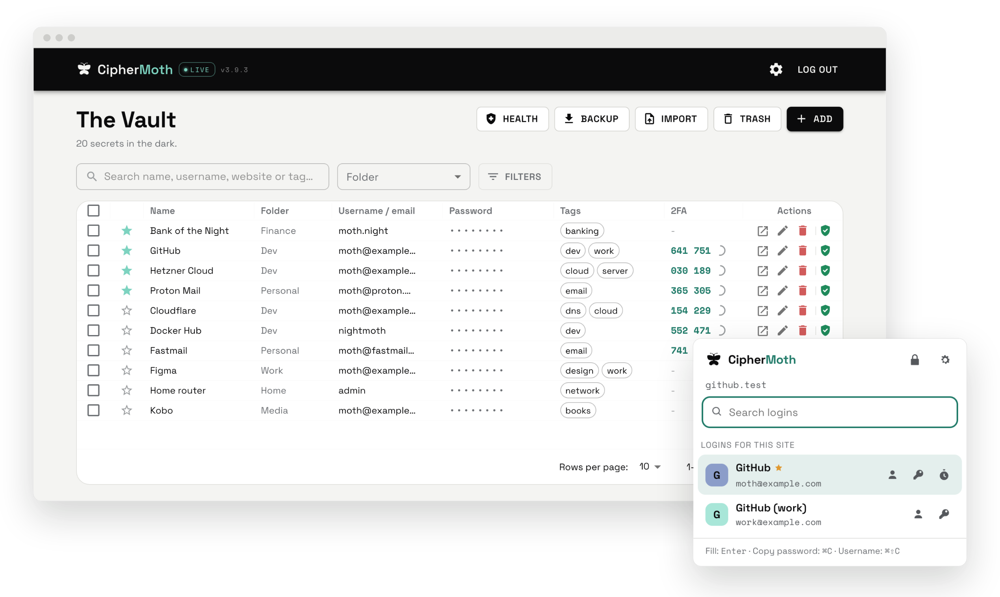
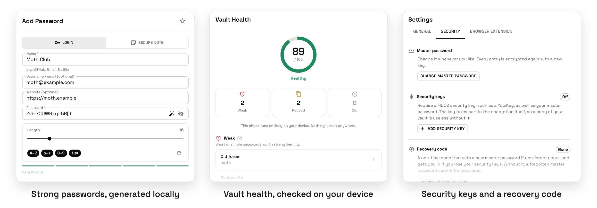

<p align="center">
  
</p>

<p align="center">
  <a href="https://github.com/mr-grj/ciphermoth/releases/latest"></a>
  <a href="https://github.com/mr-grj/ciphermoth/actions/workflows/ci.yml"></a>
  <a href="LICENSE"></a>
</p>

**CipherMoth is a password manager that lives on your own computer.** One master password, no account, no cloud, no telemetry, and a browser extension that fills only when you ask.

I built it for myself because every password manager wanted my email address, a subscription, and ideally my soul too. I wanted something that keeps working offline, never phones home, and won't announce one day that it has been acquired and is moving to a new platform. So here it is.

## Download

| Your computer | Download |
|---|---|
| **macOS** | [Apple Silicon](https://github.com/mr-grj/ciphermoth/releases/latest/download/CipherMoth_darwin-aarch64.dmg) · [Intel](https://github.com/mr-grj/ciphermoth/releases/latest/download/CipherMoth_darwin-x86_64.dmg) |
| **Windows** | [x64](https://github.com/mr-grj/ciphermoth/releases/latest/download/CipherMoth_windows-x86_64.exe) · [ARM64](https://github.com/mr-grj/ciphermoth/releases/latest/download/CipherMoth_windows-aarch64.exe) |
| **Linux** AppImage | [x64](https://github.com/mr-grj/ciphermoth/releases/latest/download/CipherMoth_linux-x86_64.AppImage) · [ARM64](https://github.com/mr-grj/ciphermoth/releases/latest/download/CipherMoth_linux-aarch64.AppImage) |
| **Linux** .deb | [x64](https://github.com/mr-grj/ciphermoth/releases/latest/download/CipherMoth_linux-x86_64.deb) · [ARM64](https://github.com/mr-grj/ciphermoth/releases/latest/download/CipherMoth_linux-aarch64.deb) |
| **Browser extension** | [Chrome Web Store](https://chromewebstore.google.com/detail/ciphermoth/gjdobbdnepjkgfpcmhjdagkcjholjkkd) (also Brave, Edge, Vivaldi) · [Firefox Add-ons](https://addons.mozilla.org/firefox/addon/ciphermoth/) |

Not sure which one? On a Mac, **Apple menu → About This Mac** says "Apple M…" for Apple Silicon. Most Windows and Linux PCs are x64. Everything else (checksums, provenance, older versions) is on the [releases page](https://github.com/mr-grj/ciphermoth/releases/latest).

The app is free and has no Apple notarization or Windows publisher certificate, so macOS and Windows warn you the first time you open it. [Here is how to get past that safely](docs/UPDATING.md#desktop-updates), without switching off any protection.

<p align="center">
  <picture>
    <source media="(prefers-color-scheme: dark)" srcset="docs/screenshots/showcase-dark.png">
    
  </picture>
</p>

## What it does

- **Keeps everything on your machine.** The vault is one encrypted file. It works offline, with no account, no sync service and no analytics.
- **Encrypts everything you type**, entry names included: usernames, passwords, websites, notes, 2FA secrets, tags, folders, custom fields, history and attached files.
- **Logins, secure notes and files**, with folders, tags, favorites, search, password history and a trash you can restore from.
- **Shows live 2FA codes**, generates strong passwords and checks your vault for weak or reused ones, all on your device.
- **Fills logins in your browser only when you ask**: click the toolbar button or press Ctrl/⌘+Shift+L. Nothing is drawn inside pages and nothing fills on page load. [More about the extension](docs/EXTENSION.md).
- **Optional extra locks:** a security key (YubiKey or any FIDO2 key) that becomes part of the encryption, a recovery code you keep offline, and Touch ID in the Mac app.
- **Complete encrypted backups**, plus CSV import from Chrome, Bitwarden, KeePass and Proton Pass.
- **Signed updates you choose to install.** Your vault stays put.

<p align="center">
  <picture>
    <source media="(prefers-color-scheme: dark)" srcset="docs/screenshots/features-dark.png">
    
  </picture>
</p>

## Get started

1. Download and install the app for your computer (links above).
2. Choose a strong master password: at least 12 characters, mixing at least two of lowercase, uppercase, digits and symbols.
3. Open **Settings → Security** and create a recovery code. Write it down and keep it offline.
4. Add your passwords, or import a CSV from your old password manager.
5. Optional: turn on **Settings → Browser extension → Allow browser extensions**, install the extension, and pair it by comparing a six-digit code once. [Step by step](docs/EXTENSION.md#desktop-mode).

> [!WARNING]
> **Nobody can reset your master password for you.** No reset link, no support email, no backdoor. Without a recovery code, a forgotten master password means a lost vault, permanently. That's the trade for nobody but you holding the key. Take a backup once you've added a few entries.

### Prefer a server?

The same vault core also runs as a small self-hosted web app: two Docker containers and one SQLite file. The installer is short and worth reading before you run it:

```shell
curl -fsSL https://raw.githubusercontent.com/mr-grj/ciphermoth/master/install.sh | sh
```

Then open [http://localhost:3000](http://localhost:3000). The [self-hosting guide](docs/SELF-HOSTING.md) covers servers, HTTPS, configuration, updates and the `cip` command-line client.

## Is it for you?

Probably yes if you want your passwords on your own computer, without accounts or telemetry, and you're happy owning your backups.

Probably not (yet) if you need a mobile app, family or team sharing, cloud sync, autofill that pops up in every login form, or someone else who can recover your vault. Those are real needs, just not what this is trying to be.

## Security, honestly

**CipherMoth has not been independently audited.** I use it every day and built it carefully, with the cryptography kept small and readable on purpose, but no third party has reviewed it. Weigh that accordingly.

- A random vault key encrypts every entry with AES-256-GCM. The key is stored only wrapped under your master password, stretched with Argon2id.
- Someone who copies the vault file gets ciphertext, plus some metadata: how many entries there are, timestamps and sizes. Every password guess costs them a full Argon2id run.
- It cannot protect you from malware on the computer you unlock from, a weak master password, or someone who can replace the vault file with an older copy.

[SECURITY.md](SECURITY.md) explains the full threat model and how to report a vulnerability privately. [docs/VAULT_FORMAT.md](docs/VAULT_FORMAT.md) specifies the vault and backup formats byte for byte.

## Documentation

- [Installing and updating](docs/UPDATING.md): the desktop app, the extension, Docker snapshots and older vaults
- [Browser extension](docs/EXTENSION.md): install, pair, what it can and cannot do
- [Self-hosting](docs/SELF-HOSTING.md): Docker, servers, configuration
- [Command line](docs/CLI.md): the `ciphermoth` CLI for the self-hosted edition
- [Security](SECURITY.md) and [privacy](docs/PRIVACY.md)

## Contributing

Bug reports, ideas and pull requests are welcome. [CONTRIBUTING.md](CONTRIBUTING.md) gets you from clone to a running dev vault in a few commands. Found a security problem? Please report it [privately](https://github.com/mr-grj/ciphermoth/security/advisories/new), not in an issue.

## License

[MIT](LICENSE). Built at night, for people who'd rather keep their secrets to themselves.
